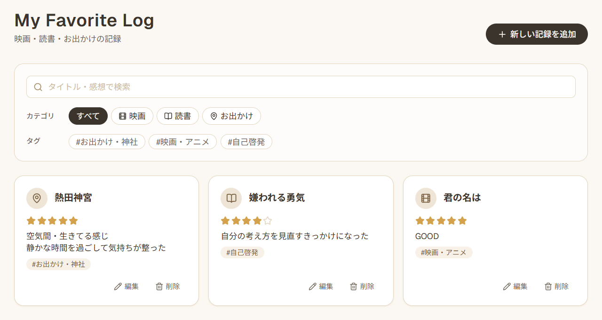

# My Favorite Log

映画・読書・お出かけの記録をカード形式で残せる、シンプルな趣味ログアプリです。

タイトル・体験日・一言感想・星評価・タグを記録して、あとから一覧や検索で振り返れます。データはブラウザの LocalStorage にだけ保存されます。ログインやサーバーは不要です。



映画・読書・お出かけの記録をカード形式で管理できます。

## 主な機能

- **記録の登録・編集・削除**
  - カテゴリ（映画 / 読書 / お出かけ）とタイトルが必須です。体験日、一言感想、星評価、タグは任意です。
  - 登録と編集はモーダルで行います。入力エラーは該当する項目の近くに表示します。
  - 削除の前には確認を表示します。
- **カード一覧**
  - 登録日時の新しい順に並べます。
  - 未入力の項目はカードに表示しません。
- **検索**
  - カテゴリ・タグ・キーワードの条件は AND で組み合わせます。
  - タグは既存タグの一覧から複数選べます。選んだタグのいずれかを持つ記録が一致します（OR）。
  - キーワードはタイトルと一言感想を対象に部分一致で検索します。大文字・小文字は区別しません。
- **星評価**
  - 1〜5 で評価します。選択中の星をもう一度押すと、評価を解除できます。
- **タグ**
  - 1つずつ入力して追加するチップ形式です。入力時に、既存のタグを候補として表示します。
  - 前後の空白は取り除きます。同じ記録内の重複は無視します。大文字・小文字は区別します。
- **データ保護**
  - 保存データが壊れているときや読み込めないときは、警告を表示します。そのあいだ登録・編集・削除を停止し、元のデータは削除も上書きもしません。

## 使い方

1. 画面上部の「新しい記録を追加」を押して、カテゴリとタイトルを入力し、「保存」を押します。
2. 登録した記録は、カードとして一覧に表示されます。
3. 画面上部の検索欄で、カテゴリ・タグ・キーワードを使って絞り込めます。
4. カードの「編集」「削除」で記録を変更または削除できます。
5. モーダルは「キャンセル」または Esc キーで閉じます。入力途中の内容は破棄されます。背景をクリックしても閉じません。

## 技術スタック

| 分類 | 使用技術 |
|---|---|
| フレームワーク | [Next.js](https://nextjs.org) 16（App Router） / React 19 |
| 言語 | TypeScript |
| スタイル | Tailwind CSS v4 |
| アイコン | [lucide-react](https://lucide.dev)（映画 = Film、読書 = BookOpen、お出かけ = MapPin） |
| テスト | Vitest / Testing Library / jsdom |
| データ保存 | ブラウザの LocalStorage |
| パッケージ管理 | npm |

## 起動方法

Node.js 22.12 以上が必要です（Next.js 16 と Vitest 5 の要件に基づきます）。

```bash
npm install
npm run dev
```

ブラウザで <http://localhost:3000> を開きます。

本番用にビルドして起動する場合は、次のコマンドを使います。

```bash
npm run build
npm run start
```

## テスト方法

```bash
npm test                                  # すべてのテストを実行
npx vitest run lib/validation.test.ts     # ファイルを指定して実行
npx vitest run -t "テスト名"               # テスト名を指定して実行
npm run lint                              # ESLint
```

主なテスト対象は次のとおりです。

- 保存データの破損判定（`lib/validation.test.ts`）と日付の実在判定（`lib/date.test.ts`）
- LocalStorage の読み込み・保存（`lib/storage.test.ts`）
- 検索、タグ、フォーム、記録の操作（`lib/*.test.ts`）
- 画面の操作（`components/*.test.tsx`）
  - 登録・編集・削除
  - 0件表示
  - 破損データの保護と「再読み込み」

## LocalStorage への保存について

- 記録は、ブラウザの LocalStorage のキー `my-favorite-log-records` に JSON 配列として保存されます。
- データは**使っているブラウザの中にだけ**保存されます。ほかの端末やブラウザとは共有されません。ブラウザのサイトデータを消去すると、記録も消えます。
- 記録の形式は次のとおりです。任意項目は、未入力のときは項目自体を保存しません。

  ```json
  {
    "id": "UUID（自動生成）",
    "category": "映画",
    "title": "タイトル",
    "experienceDate": "2026-11-01",
    "comment": "一言感想",
    "rating": 4,
    "tags": ["感動", "家族"],
    "createdAt": "2026-11-01T03:17:13.000Z"
  }
  ```

- 読み込むたびに、保存データの形式を検証します。次のような場合はデータの破損として扱い、警告を表示します。
  - JSON として読み込めない
  - 必須項目が欠けている
  - ID が重複している
  - 値の型や範囲が正しくない

  破損しているあいだは、**元のデータを削除・上書きせず**、登録・編集・削除を停止します。データを修正してから警告内の「再読み込み」を押すと、もう一度検証します。正常なデータを確認できれば、操作を再開します。
- 保存に失敗した場合（容量不足など）は、その旨を画面に表示します。既存のデータは変更しません。

## ドキュメント

- [`my-favorite-log-requirements.md`](./my-favorite-log-requirements.md): 要件定義書（仕様の正本）
- [`CLAUDE.md`](./CLAUDE.md): AI コーディングアシスタント（Claude Code）向けの開発ガイド
